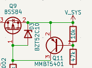
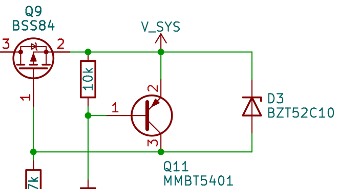

# 局部构图对照与校准候选

## 已确认的局部组织偏好

来源：用户于 2026-10-31 提供的一组人工调整图与 agent 自动图，并明确指出 D3 是 Q9 的栅极保护稳压管，应在 MOS 旁表达保护关系。下面仅保存相关局部供需要时对照；不要求日常重新读取整套历史图学习风格。

| 用户调整后的局部 | agent 原局部 |
|---|---|
|  |  |

可迁移的判断：D3 与 Q9 的 G/S 构成直接可辨的局部，Q11 的控制支路从该局部展开；不能仅因 D3、Q11 接到同一对网络，就把 D3 放到 Q11 的远侧。两张完整图还显示，人工图把 U4/Q12 的分压、滤波和反馈保留为完整局部，跨到 Q8/Q10 的 REGEN_H 用各端标签表达；自动图的长公共横线则牵制这些局部的位置。这些是功能组织依据，不是要求复制固定坐标。

认可范围限于用户指出的保护归属和功能组织方向。截图缩放、可见电路范围不同，局部裁图的边缘有截断线路；它们不用于测量面积缩减、证明网表等价，也不把截图所有字号、标签朝向、字段摆法或器件参数自动设为标准。D3 角色来自用户说明，其他电气意图仍需目标源与器件资料核实。执行规则以 [functional-layout.md](functional-layout.md) 和 [drawing-conventions.md](drawing-conventions.md) 为准。

## 实际整改案例：完整迟滞回路

2026-10-31 的 20 W 分立电子负载整改，电路参数不变。两张均为 KiCad 10.0.5 原生 PDF 的同倍率局部裁图，不以浏览器显示宽度比较绝对尺寸。

- [重排前：NTC、比较级、阈值与输出分别通过标签连接](composition-examples/eload-before.png)
- [整改候选：输入、差分/镜像、输出与迟滞返回形成连续局部](composition-examples/eload-after.png)

可复用的是组织方法：先把决定同一个功能的输入、核心、输出及局部反馈排在一起，再安排对外接口。整改后的 HOT_N 仍可通过标签连接独立使能核心；保留在线网名不意味着把线断开。RV4 的滑臂在地符号锚点之前汇合，不沿地符号向下回接。

本例全图核对了 66 个实物位号、163 个引脚及 36 个网络，参数、身份和网络端点保持；A3 改为 A4，字高仍为 1.27 mm。此前独立图面复核追读了主环路、迟滞和关断，并修复过部分字段碰线；这不证明其余字段全部合格。**用户于 2026-11-01 明确否定最终全图的紧凑度，指出仍松散并认为可放入 A5。** 本例只说明完整回路比标签小岛更易跟读，不是紧凑度合格样例。上排级间空跨度、驱动补偿回线和功率级长返回仍需检查；A5 未试排，用户判断不替代实际适配证据。不能因功能连贯、无碰撞或已从 A3 缩为 A4 就接受密度，也不能复制其坐标作为模板。工程证据位于本机 `C:/Users/wuji/Desktop/Discrete_CC_Load_20W_20261031/verification/layout_20261031/`；本案例的可视内容保存在本包内，不要求读取该工程。

## Synthetic visual calibration candidates

**Status: PENDING_USER_APPROVAL for the six synthetic candidates below.** These examples
have not been selected or approved by the user. Use them only to discuss local
spacing and field fit, not as a style score or a substitute for reviewing the
current schematic. Numerical spacings below describe fixtures, not universal
layout thresholds.

The six native `.kicad_sch` files use bundled `Device:C` / `Device:R` definitions
at their normal size, with 1.27 mm fields. They are synthetic exercises; their
terminal labels are net-check anchors, not examples of production power-symbol
conventions. No user project is read or modified by the generator.

| Panel | What it isolates | Electrical comparison |
| --- | --- | --- |
| [Capacitor spacing](calibration-candidates/capacitor-spacing.png) | Loose: 17.78 mm pitch and 7.62 mm half-bus height. Compact candidate: 7.62 / 3.81 mm. Intentional collision: 3.81 / 3.81 mm. | All three contain C1=100nF and C2=1uF on the same two nets. |
| [Resistor fields](calibration-candidates/resistor-fields.png) | Short `10k` fits inside; `17.4k` hits the border; the same `17.4k` is placed outside. | Only the two long-value layouts are electrically equivalent. The short-value example intentionally has a different value. |

The PNGs are crops of native KiCad PDF exports. Each three-panel group uses the
same crop and scale; the capacitor and resistor groups have different scales.
The headings and footer are contact-sheet annotations, not schematic content.
The intentional collision examples must not be copied as acceptable layouts.

## Reproduce and verify

From the skill directory, use a dedicated output directory. The script overwrites
its six known fixture filenames and generated reports in that directory.

```powershell
python scripts/render_calibration.py --output "$env:TEMP\kicad-style-calibration" --kicad-cli "D:\app\KiCad\10.0\bin\kicad-cli.exe" --png
$env:KICAD_CLI = 'D:\app\KiCad\10.0\bin\kicad-cli.exe'
python -m unittest discover -s tests -p test_render_calibration.py -v
```

Generation and native netlist validation use the Python standard library.
`--png` additionally requires PyMuPDF. Without `--library`, definitions come from
the bundled fixtures; an explicit `--library path/to/Device.kicad_sym` allows a
different installed library and may change appearance and source hashes.

`verification.json` records the KiCad version, source/PNG SHA-256 hashes and
checks native component identity (reference, value, footprint, datasheet,
library and part) plus named pin-endpoint sets against the expected fixture.
It also compares the three capacitor variants and the long-resistor pair.
This catches a shared wiring error even when all variants agree with each other.

The bundled candidates were regenerated and viewed using KiCad CLI 10.0.5,
Python 3.14.7 and PyMuPDF 1.28.2. The observed distinctions are visible without
crop clipping: loose/compact/colliding capacitors and inside/border/outside
resistor fields. The capacitor RETURN label is clear of its bus. All three
calibration tests passed, including rejection of a deliberately shared short.

These checks establish native parse/export success and the stated component/net
equivalence. They do not establish ERC acceptance, a GUI save round trip,
automatic glyph clearance, whole-page quality, or user aesthetic approval.
Reinspect newly rendered PNGs after changing KiCad, fonts, libraries or geometry.
