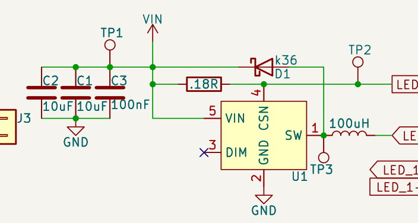
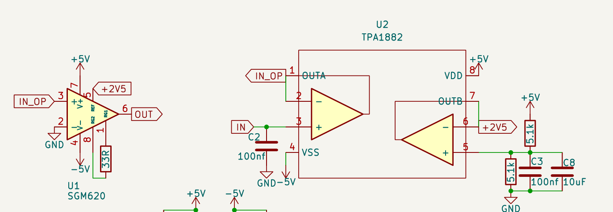
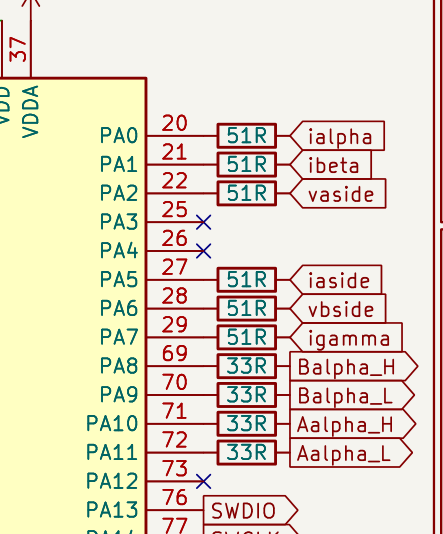
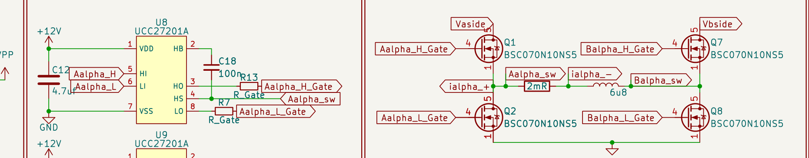

# 规范来源档案：五个历史工程

**本文件不属于日常绘图的必读流程。** 绘制、整理和审查直接按 SKILL.md 的明确规则执行，不从这里的整图或统计重新推断风格。只有用户要求重新提炼规范、核对来源或明确指定某张图时才查阅；发现历史画法与规范不同，不自动把它升级为例外。

这些图来自用户指定的五个**主文件**，于 2026-10-27 用 KiCad 10.0.5 原生 SVG 导出后栅格化。局部图只是同一原生导出的裁切，没有重新绘制电路。它们记录规范提炼时的证据，不代表电路已通过设计审查。源工程以后可能变化，此处保留当时的快照。原始工程只读，忽略 `.history`、`backups` 和生产快照。

## 溯源索引

| 场景 | 历史工程与整页图 | 当时记录的特征 |
|---|---|---|
| 小功率电路/紧凑接口 | [Bullet_Charger](examples/Bullet_Charger.png) | A5 无框；框内阻值；紧凑并联电容；重复接口；大块页边空白 |
| 运放/模拟小板 | [OP](examples/OP.png) | A5 无框；竖电阻内竖读值；IC 端点直贴标签；去耦成组 |
| MCU/通信/外设 | [SuperCap_Ctrl](examples/SuperCap_Ctrl.png) | A4 拼接功能区；MCU 引脚串阻标签一体；底部成排去耦 |
| 多路驱动/采样/桥臂 | [SuperCap_Power](examples/SuperCap_Power.png) | A4 左/中/右功能列；整组重复；栅驱与功率级用标签关联 |
| 多单元电源控制器 | [SuperCap_V2](examples/WEILAI_SuperCap_V2.demo.1.png) | A5 无外框；U1 分功能单元；双桥臂；保护电路独立成团 |

### 原始路径

- `D:\Projects\Bullet_Charger\Bullet_Charger\Bullet_Charger.kicad_sch`
- `D:\Projects\OP\OP.kicad_sch`
- `D:\Projects\WEILAI_SuperCap\hardware\SuperCap_Ctrl\SuperCap_Ctrl.kicad_sch`
- `D:\Projects\WEILAI_SuperCap\hardware\SuperCap_Power\SuperCap_Power.kicad_sch`
- `D:\Projects\WEILAI_SuperCap_V2.demo.1\WEILAI_SuperCap_V2.demo.1.kicad_sch`

原始文件不在不影响执行 SKILL.md；不要为了使用技能去寻找或恢复这些工程，也不要复制未知库名、参数或器件数据。图集不提供设计选型依据。

## 证据与尺度

统计只读主文件根级实例，不计 lib_symbols 模板。隐藏电阻数按真实 R 位号统计，不含电源符号。计数是观察值，**不是新图必须达到的配额**。

| 工程 | 页面 | 功能框 | 电阻数 / 隐藏位号 | 全局 / 局部标签 | 非正交导线 |
|---|---|---:|---:|---:|---:|
| Bullet | A5 | 0 | 1 / 1 | 6 / 0 | 0 |
| OP | A5 | 0 | 3 / 3 | 8 / 0 | 0 |
| Ctrl | A4 | 8 | 31 / 24 | 72 / 6 | 0 |
| Power | A4 | 6 | 21 / 5 | 105 / 0 | 0 |
| V2 | A5 | 0 | 21 / 21 | 30 / 0 | 0 |

- 五图非电源器件的非空可见属性均以 1.27 mm 为主；V2 四只功率 MOS 型号为 1.0 mm。大图标题多为 2.286 mm 斜体。
- 大图功能框是 0.2032 mm 暗红色无填充矩形，常见框间隙为 0.635 mm；框内器件仍须留出可读空间。
- 短线、直贴引脚与本地母线反复出现；没有“每条导线必须同长”或“每块周围至少留 5.08 mm”的证据。

## 局部证据记录

### A. 框内值 + 并联电容组

- Bullet R1 中心 `(62.23,44.45)`：隐藏 Reference，`.18R` 位于水平矩形内部。新填阻值建议写完整前导零，但纯重排保留原字符串。
- L1 `(83.82,52.07)`：位号隐藏，`100uH` 在线圈上方，不是所有无源统一“位号上、值下”。
- C2/C1/C3 同在 `y=45.72`，`x=38.10/43.18/48.26`；上下短母线并接，用共同地符号，字段贴近极板。5.08 mm 是此组实测中心距，不是通用硬尺寸。
- J1/J2 同向、同引脚标注方式，表达同一种接口时复用整组几何关系。

### B. 竖电阻值随长轴阅读

- OP R1 `(69.85,49.53)`、R4 `(153.67,44.45)`、R5 `(149.86,52.07)` 均隐藏位号，值在竖直矩形内部竖读。
- OP U1.6 的 OUT 标签与引脚端点 `(74.93,40.64)` 重合；U1.3 的 IN_OP 标签在 `(59.69,38.10)` 直接接端点。不要添加无意义引出线。
- Bullet 水平电阻和 OP 竖电阻的 property at 原始角度都可能是 90；纸面方向必须结合实例变换并看渲染确认。
- OP 显示连接器通用 Value，Bullet 隐藏；这项属于局部选择，不应全局统一。

### C. MCU 引脚、串阻、标签同轴贴接

- Ctrl U1 右侧引脚端点 `x=74.93`，R23 中心 `(78.74,27.94)`，两端 `x=74.93/82.55`，ialpha 标签锚点 `(82.55,27.94)`。
- 这个完整连接可以没有中间 wire：引脚端点 = 电阻左端，电阻右端 = 标签锚点。复制此关系，而不是复制固定的长引线。
- R23 至 R41 构成相同 x 列，行距服从对应 MCU 引脚。较长/不同功能的标签按端点安排，不能改信号映射来凑顺序。
- Ctrl 有 7 只电阻仍显示位号；R1/R19 的值在框内但位号在外侧。框内值与隐藏位号不能绑定成唯一模式。

### D. 驱动器和功率级分区，但各自保持局部拓扑

- Power U8/U9/U10 沿 `x=153.67` 排列，`y=22.86/45.72/68.58`；U11/U12/U13 为第二组三路。每一路复制供电、bootstrap、两只栅阻、输入和输出标签的相对关系。
- 栅驱输出用 `_Gate`、`_sw` 标签对接功率级；不需要跨分区拉整页长线。桥臂内部的上下管、分流器、电感仍用实线连接。
- Power R7 至 R18 为 `R_Small`，位号上、值下；R2 至 R5 分压电阻在右侧显示两行。不能把“隐藏位号 + 框内值”强行套给这些已有局部。
- 此局部的 C12 字段与输入标签过近；学习拓扑和字段策略，不复制这处拥挤。Power 采样区的独立分流器与 INA240 通过成对标签关联，也是允许的局部表达。
- 三组桥臂、两组储能电容保持一致。Ctrl MCU 的去耦也在所属功能框下方成排，不必逐颗挤在顶端电源脚旁。

## 不要继承的参考缺陷

这些问题说明风格和设计完整性要分开验收；本次提炼风格没有修改参考工程。

- Bullet U1 的 Value 为空；不能因此把新 IC 的型号删除。
- OP 中的 `Local supply bulk capacitors / external supply flags` 等说明文字不属于必须继承的风格。执行 SKILL.md 的内容克制规则，不因历史图上有句子就给新图添加说明或流程备注。
- Ctrl 的 `XC6206PxxxMR`、Power 的 `R_Gate` 和异常电感位号 `u`，不能作为新设计的有效选型/身份模板。
- V2 仍有 `TBD`、电容值 `C` 等未决内容。它们只允许作为明确标识的草案，不是发布版风格。
- V2 C12 至 C23 的实例原点在 `x=218.44 mm`，超过 A5 横向 210 mm 宽度；整页 PNG 会裁掉这些器件。因此要检查源对象范围，不能以 PNG 看着整洁代替完整性检查。
- 参考中存在字段紧挤、个别框重叠和多种单位写法。继承紧凑组织方式，不继承碰撞、裁切、异常身份或不明确的参数。

## 提炼时记录的取舍

下表用于解释规范来源；绘图时以 SKILL.md 中包含可读性前提、字段策略和局部构图的完整规则为准。

| 容易误用的通用规则 | 本技能的处理 |
|---|---|
| 所有位号都必须显示 | 器件身份必须保留；可见性按器件类别和局部样板决定 |
| 所有字段都横读、放在符号外 | 标准矩形电阻优先框内、沿长轴；其他字段按可读性安排 |
| 每个标签必须留短引线 | 可直贴真实引脚端点，只有必要时引出 |
| 功能标题固定左上，模块间留大空隙 | 简单图可无标题/无框；复杂图紧密拼框，标题放空角 |
| 为保持关键回路必须连接所有跨区线 | 保持局部拓扑连续；跨功能端口可用成组标签 |
| 去耦必须逐颗紧贴 IC 的每个电源脚 | 允许所属功能区内部成组，电气归属清楚 |
| 把所有网名改成大写 | 沿用已有信号族和接口语义，不为风格更名 |
| 参考是什么样就全部照搬 | 复制视觉惯例，同时识别占位、遮挡、页外器件等缺陷 |
